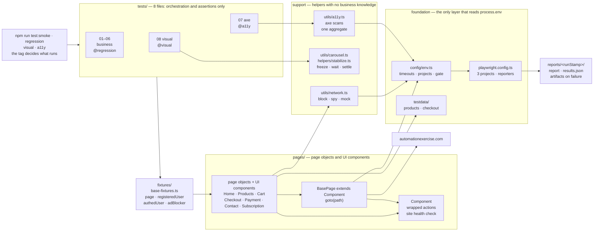

# Architecture Overview

> One diagram, then the rules behind it. Mermaid renders natively on GitHub, in VS Code (Mermaid extension), Typora and most Markdown viewers.

This repository is a Playwright + TypeScript end-to-end framework for the public Automation Exercise storefront. It
verifies customer-facing journeys only (TC7, which merely opens the site's own Test Cases listing page, is excluded).
Four layers, Page Object Model, composable fixtures, centralised config/data — and Playwright's own reporting.

## 1. The framework in one picture

**How to read it.** Arrows point in the dependency direction, left to right, and nothing ever points back upstream.
That single constraint is what makes the suite maintainable, and each layer has exactly one rule:

| Layer | Rule | What breaks without it |
|---|---|---|
| `tests/` | Orchestrate and assert; no locators | One UI change becomes an eight-file edit |
| `pages/` | One class per page, business verbs, no test-intent assertions | Flows cannot be reused by the functional, visual and a11y suites alike |
| `utils/` + `helpers/` | Pure helpers, no business knowledge | Waiting/retry logic gets copied into every test |
| `config/` + `testdata/` | Only place that reads `process.env` | Tests become machine-dependent and stop reproducing anywhere else |

Every user action goes through the wrappers in `Component` (`click`, `fill`, `check`, `selectOption`, `pressKey`,
`scrollTo`, `setInputFiles`, `clickAndWaitForDownload`). Page objects inherit them through `BasePage`, which adds
`goto(path)`; reusable UI components such as the subscription section inherit `Component` directly. The wrappers
check site health so an overloaded site reports a useful cause instead of "element not found".

## 2. Suites and viewports

| Command | Chrome | What it proves |
|---|---:|---|
| `npm run test:smoke` | 2 | Register → search → add to cart → logout → delete, plus one real form submission (≤ 3 min) |
| `npm run test:regression` | 18 | Everything functional, negative branches included; the 2 smoke tests are excluded by `--grep-invert` |
| `npm run test:gate` | 2 + 18 | Smoke first, then regression; regression still runs if smoke fails |
| `npm run test:regression:all-viewports` | 36 | 18 non-smoke regression tests each on Chrome and mobile Chromium |
| `npm run test:visual` | 3 × 3 viewports | Full-page pixel comparisons, one baseline set per viewport (30 files) |
| Manual `visual-update` | 3 × 3 viewports | Regenerates visual baselines; publishes the snapshots as an artifact for review and manual commit |
| `npm run test:a11y` | 3 | axe scans with a severity gate |

| Project | Viewport | Site band | Runs |
|---|---|---|---|
| `chrome` | 1280 × 720 | `lg` (≥ 1200) | functional, visual, axe |
| `tablet-chrome` | 800 × 1280 | `sm` (768–991) | **visual only** — project-level `grep: /@visual/` |
| `mobile-chrome` | 412 × 839 (Pixel 7, DPR 2.625) | `xs` (< 768) | functional, visual |

Three points a reviewer will ask about:

- **The tablet project costs nothing extra.** `grep` at project level means `--project=tablet-chrome --list` is 3 tests,
  not 27. Scope is declared on the project, not sprinkled as `test.skip` through the specs.
- **800, not 768.** 768 sits on the breakpoint; one vertical scrollbar eating ~15 px drops the layout into `xs` and the
  baseline records the wrong band. 800 is safely inside `sm`.
- **`md` (992–1199) is deliberately not baselined.** It differs from `lg` only by a 970 px container plus six `md`-only
  alignment rules; the site has no `col-lg-*` and its only `col-md-*` usage also applies at 1280, so `md` can produce a
  *misaligned* layout but not a different one. Documented rather than implied.

Firefox / Edge / WebKit / iPhone 13 are present but commented out: the tagged functional suite (20) × 6
functional-capable projects = 120 serial runs against a shared public store, and the site throttles. The tablet
project remains visual-only. Execution is serial by design
(`workers: 1`, `fullyParallel: false`) — the site's rate limiting, plus `utils/a11y.ts` keeping its aggregate in module
scope, where a second worker would silently write a partial report. `env.ts` names projects as strings, so the config
validates them at load time and a rename fails fast instead of every visual/a11y test quietly skipping.

## 3. Execution model

`registeredUser` → `authedUser` is a two-level fixture chain: the fixture registers a unique account, asserts
`Logged in as NAME`, hands `{ page, user }` to the test, then registers its cleanup **after** `use()`. Cleanup therefore
runs even when the test body throws — that is what stops the shared demo site from accumulating orphaned accounts. The
`page` fixture adds a post-test check for the site's queue-full page: if the run was otherwise green it throws with a
clear reason, and if the test already failed it attaches the body text as an annotation so the original failure survives.

## 4. Why the visual suite is stable

The home hero and the recommended-items strip are Bootstrap 3 carousels on a 5-second JS timer, which
`animations: 'disabled'` does not stop. Every capture is preceded by: freeze the carousels (remove `data-ride`, reset to
slide 1, pause the interval) → bounded wait for fonts and images → reject completed broken images with their URLs →
move the mouse away → settle 300 ms → `toHaveScreenshot`. Broken external images abort the capture without retry.

Two consequences worth noting: freezing also fixes the add-to-cart race (the product id is read and clicked in the same
resolution as the freeze), and screenshots are **full page**, so header, recommended items and footer subscription are
inside the baseline. The threshold is a **ratio** of page area (1%, 2% on the narrower viewports) because page height
varies with content while a ratio stays meaningful.

## 5. Reporting

One directory per invocation (`reports/<runStamp>/`), nothing from a previous run is overwritten: `report/index.html`,
`results.json`, and `artifacts/` which only receives files on failure (`trace` / `screenshot` / `video` are all
`*-on-failure`). Visual tests are the exception people trip over: `toHaveScreenshot` captures on **every** run because the
capture *is* the comparison; only `-expected` / `-actual` / `-diff` are written, and only on a mismatch. Accessibility
keeps its own never-overwritten `reports/a11y/axe-scan-<timestamp>.json` with per-page scans and rule-level aggregates
(`pageCount`, `affectedPages`, `nodeCount`, selector samples); `AE_A11Y_GATE=critical` (default) fails the suite on
critical findings, `record` only records — which keeps pre-existing site debt from turning the build red.

## 6. Decisions to defend in review

| Decision | Alternative | Why this one |
|---|---|---|
| POM + fixtures, no raw locators in tests | Flat files with inline selectors | A layout change touches one page object, not nine specs |
| `data-qa` and stable `href` | CSS class / XPath | Classes are styling hooks; `data-qa` is the site's own automation contract |
| Serial, single worker | Parallel for speed | Shared public site throttles; a11y aggregate is module-level state |
| Severity gate, not zero violations | Fail on any violation | A suite that is red on day one gets ignored |
| Diff as a ratio | Fixed pixel count | Full-page height varies; a ratio is stable across pages and viewports |
| Freeze carousels | Mask the carousel region | Masking hides a real regression; freezing keeps it under test |
| One report directory per run | Single overwritten `reports/` | Last run's evidence is how you compare a new failure with a known-good state |

## 7. Known limits

- The site can return a queue-full page mid-run → `BasePage` fails fast, the `page` fixture annotates it as `site-overload`.
- Accounts are cleaned up; reviews and contact messages cannot be deleted — an accepted side effect of testing a public demo.
- Product prices and ids are hard-coded on purpose: a price change *should* fail the suite.
- Visual baselines are OS- and font-dependent (`-win32`); regenerate with `npm run test:visual:update` on the target OS.

## 8. References

- [Automation test plan](./automation-test-plan.md) — the site's 26 official scenarios mapped to coverage.
- [AI usage log](./ai-usage-log.md) — where AI-generated code was adopted, corrected or rejected.
- [README](../README.md) — setup, commands, selector strategy, known quirks.
